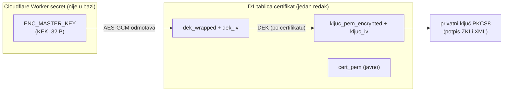
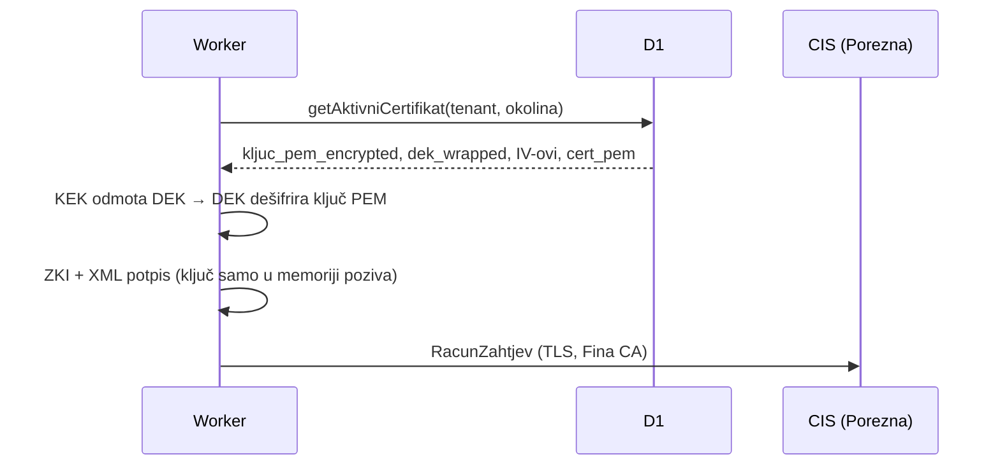
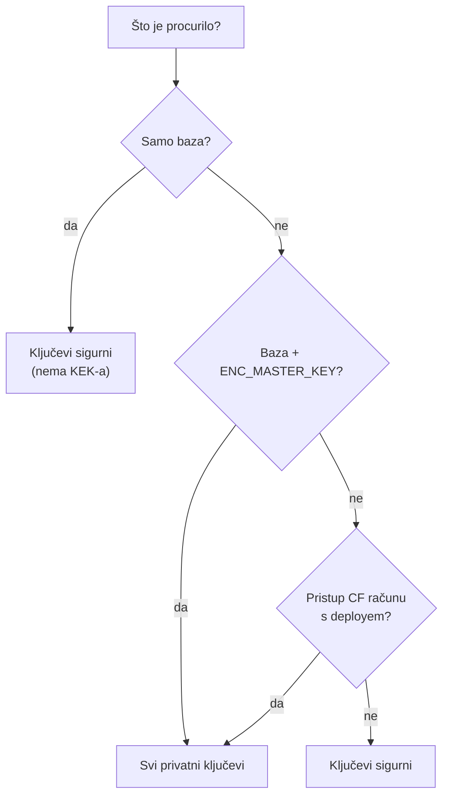

# 21 — Kako se spremaju certifikati i lozinke (i što curi kad curi baza)

Stanje koda: `main` @ 2026-11-12 (nakon refactora koraka 4). Izvori su datoteke
u repou (navedene uz svaku tvrdnju) i Cloudflare dokumentacija (pristupljeno
2026-11-12). Pisano kao odgovor na pitanje vlasnika: *ako baza negdje procuri,
može li netko preuzeti tuđe certifikate ili lozinke?*

## 1. Kratki odgovor

- **Lozinka P12 se ne sprema nigdje.** Koristi se samo u memoriji upload
  zahtjeva da se iz P12 izvuče privatni ključ, i tu nestaje
  (`backend/src/admin/app.ts`, ruta `POST /tenant/:id/certifikati`).
- **Privatni ključ i P12 su u bazi (D1) samo šifrirani**, AES-256-GCM, ključem
  (DEK) koji je i sam šifriran glavnim ključem (KEK). **KEK nije u bazi**: on je
  Worker secret `ENC_MASTER_KEY` (`backend/src/kripto.ts`).
- Dakle: **sama baza** (dump, backup, Time Travel, ukradeni D1 token) **ne daje
  ništa upotrebljivo** — samo javni dio certifikata (`cert_pem`) i metapodatke.
- **Baza + `ENC_MASTER_KEY` zajedno daju sve privatne ključeve.** Tu je danas
  stvarna slabost: isti `ENC_MASTER_KEY` je lokalno u `backend/.dev.vars`, na
  TEST-u i na PROD-u (§5.1), a na istom laptopu je i PROD dump baze.

## 2. Što je gdje

| Podatak | Gdje živi | Oblik | Tko ga može pročitati |
|---|---|---|---|
| Lozinka P12 | nigdje (samo RAM upload zahtjeva) | — | nitko nakon zahtjeva |
| Privatni ključ (PKCS8 PEM) | D1 `certifikat.kljuc_pem_encrypted` | AES-256-GCM, DEK, IV `kljuc_iv` | samo uz KEK |
| Cijeli P12 | **nigdje** od migracije `0011` (K16); prije u `pkcs12_encrypted` | — | — (ostaje samo SHA-256 otisak) |
| DEK (po certifikatu) | D1 `certifikat.dek_wrapped` | AES-256-GCM pod KEK-om, IV `dek_iv` | samo uz KEK |
| KEK | Worker secret `ENC_MASTER_KEY` | 32 bajta hex | Worker u runtimeu; nitko ga ne može pročitati natrag iz Cloudflarea |
| Javni certifikat | D1 `certifikat.cert_pem` | plaintext | svatko s bazom (javan je i ionako) |
| doku API token | D1 `doku_konfig.token_encrypted` | isti envelope (`enkriptirajTajnu`) | samo uz KEK |

Cloudflare: vrijednost secreta se nakon postavljanja ne prikazuje ni u
dashboardu ni u Wrangleru — samo Worker je vidi u `env`
([Workers secrets](https://developers.cloudflare.com/workers/configuration/secrets/)).
D1 Time Travel čuva povijest baze 30 dana na plaćenom planu
([D1 Time Travel](https://developers.cloudflare.com/d1/reference/time-travel/)),
pa „obrisani” šifrirani redovi postoje još 30 dana. To je u redu dok KEK ne curi.

## 3. Envelope enkripcija (struktura)



Svaki certifikat ima vlastiti nasumični DEK; KEK samo omata DEK-ove. Zato
rotacija KEK-a ne traži ponovni upload certifikata: dovoljno je odmotati svaki
`dek_wrapped` starim i omotati novim KEK-om (§6).

## 4. Tokovi

### 4.1 Upload (admin)

```mermaid
sequenceDiagram
  participant A as Admin (preglednik)
  participant W as Worker
  participant DB as D1
  A->>W: POST /admin/tenant/:id/certifikati (P12 + lozinka)
  W->>W: parsirajP12(p12, lozinka) — node-forge, u memoriji
  W->>W: provjera OIB-a certifikata = OIB tenanta
  W->>W: novi DEK; AES-GCM(ključ PEM) — P12 se odbacuje
  W->>W: AES-GCM(DEK) pod KEK-om iz ENC_MASTER_KEY
  W->>DB: INSERT certifikat (šifrirano + cert_pem + metapodaci)
  Note over W: lozinka i plaintext ključ<br/>nestaju s krajem zahtjeva
```

Izvor: `backend/src/admin/app.ts` (upload), `backend/src/fiskal/certifikat.ts`
(`parsirajP12`), `backend/src/kripto.ts` (`enkriptirajCertifikat`). Upload
postoji samo u adminu (Cloudflare Access + passkey, `docs/knowledge/20-*`);
javni API nema rutu za certifikate, a nijedna ruta ne vraća šifrirane stupce.

### 4.2 Potpis pri fiskalizaciji



Izvor: `backend/src/fiskal/fiskalizacija.ts` (`ucitajPotpisniMaterijal`),
`backend/src/kripto.ts` (`dekriptirajKljucPem`). Ključ se ne kešira između
zahtjeva i ne logira se.

## 5. Scenariji curenja

| Što je procurilo | Što napadač dobiva | Ocjena |
|---|---|---|
| Samo D1 (export, Time Travel, D1 API token, `secrets/prod-backup-*.sql`) | šifrirane blobove, javne certove, popis tenanata i računa | ✅ ključevi sigurni; ⚠️ poslovni podaci (računi, kupci) jesu otkriveni |
| Samo `ENC_MASTER_KEY` | ništa bez baze | ✅ |
| D1 **i** `ENC_MASTER_KEY` | **privatne ključeve svih tenanata** (potpis u njihovo ime prema CIS-u) | ❌ potpuni kompromis |
| Cloudflare račun s pravom deploya Workera | može deployati kod koji dešifrira i izvozi ključeve | ❌ potpuni kompromis (nema odvajanja dužnosti) |
| Lozinka P12 | ništa — ne sprema se | ✅ |



### 5.1 Gdje je danas KEK zajedno s bazom

1. **Isti `ENC_MASTER_KEY` lokalno, na TEST-u i na PROD-u.** Izvor:
   `secrets/ops-naucen-kontekst.local.md` (gitignored; „test worker secrets
   postavljeni upravo iz te datoteke, uklj. `ENC_MASTER_KEY` (ista vrijednost
   svugdje)”) i `HANDOFF.md` / `docs/knowledge/99-gap-analiza.md` N7 („PROD:
   isti `ENC_MASTER_KEY` kao test … čeka odobrenje”). Posljedica: tko ima
   `backend/.dev.vars` (laptop, backup laptopa, slučajni commit) i bilo koji
   PROD dump, ima PROD ključeve. TEST okolina je time jednako osjetljiva kao PROD.
2. **Na istom laptopu je PROD dump**
   (`secrets/prod-backup-2026-10-01-prije-0007.sql`) **i KEK** (`.dev.vars`).
   Taj laptop je danas jedina točka koja sama za sebe otključava sve.
3. **Izvorni P12 i njihove lozinke u plaintextu** u `backend/.tajne/`
   (`*.p12`, `lozinke.env`, gitignored). To nije problem baze, ali je isti
   laptop i ista posljedica.

### 5.2 K16 (`pkcs12_encrypted`) u ovom kontekstu

**Riješeno 2026-11-12:** migracija `0011_k16_bez_p12.sql` briše stupce
`pkcs12_encrypted` i `enc_iv`, a upload više ne šifrira P12. Obrazloženje
(zašto to nije bila zaštita, nego higijena):

Šifrirani P12 je pod **istim DEK-om** kao šifrirani ključ PEM. Tko ima KEK,
ima ključ PEM izravno; P12 mu ne treba. Tko nema KEK, nema ni jedno ni drugo.
Brisanje P12 bloba zato **ne mijenja ni jedan redak tablice u §5**: to je
higijena (manje kopija, i P12 bi uz lozinku dao „datoteku” certifikata), ne
zaštita. Stupac je `NOT NULL` (`migrations/0001_init.sql`), pa „ne spremati”
znači upisivati prazan blob `X''` ili prebaciti tablicu migracijom.

## 6. Preporuke, po težini

1. **Zaseban PROD `ENC_MASTER_KEY`** (otvoreno od faze 4). Alat postoji od
   2026-11-12: `backend/scripts/rotiraj-kek.sh --okolina test|prod` +
   `POST /admin/kripto/rotacija` (`backend/src/kripto-rotacija.ts`). Ništa se
   ne dešifrira niti ponovno uploada: svaki `dek_wrapped` se odmota starim i
   omota novim KEK-om, `enc_key_id` postaje `ENC_MASTER_KEY:<12 hex SHA-256>`.
   Tijekom prijelaza Worker čita s oba (`ENC_MASTER_KEY_STARI`), pa nema prekida.
   Puni učinak tek kad stari KEK ne postoji **nigdje** (TEST, `.dev.vars`):
   dok postoji, stari dumpovi i 30 dana D1 Time Travela ostaju otključivi.
   PROD traži odobrenje vlasnika.
2. **`.dev.vars` neka ima vlastiti lokalni KEK** (`openssl rand -hex 32`),
   nikad TEST/PROD vrijednost. PROD KEK ne treba biti nigdje osim u
   Cloudflareu i u password manageru (za oporavak).
3. **PROD dump i P12 + lozinke s laptopa u password manager / šifrirani
   volumen**, ili obrisati dump kad više ne treba.
4. **Cloudflare račun**: 2FA, minimalni API tokeni (deploy token bez D1
   exporta i obrnuto), popis ljudi s pravom deploya. To je granica koju
   enkripcija u bazi ne može pokriti.
5. ~~K16~~ — riješeno migracijom `0011` (§5.2).
6. Dugoročno: `docs/knowledge/11-*` §4 već opisuje izbor — (B) Worker
   dešifrira u memoriji (današnje stanje) ili (A) zaseban sidecar drži ključeve
   i samo potpisuje, pa ni deploy Workera ni baza ne otkrivaju ključ. (A) je
   jedini odgovor na redak „Cloudflare račun s pravom deploya” u §5.
