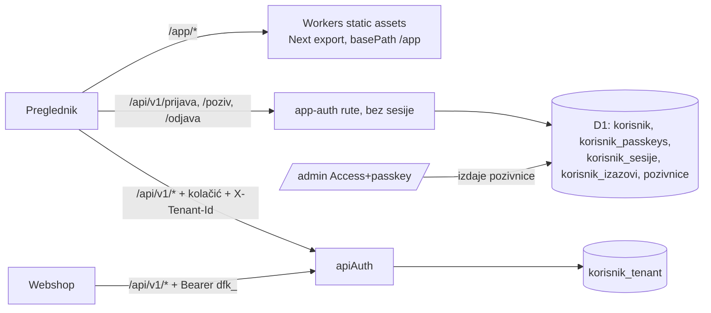

# 24 — Dashboard: passkey prijava i pozivnice

> SPOT za prijavu u **customer dashboard** (`/app`, self-service izdavanje računa). Zamjenjuje
> `16-dashboard-sso.md` (dijeljeni GoTrue) od 23. 11. 2026. Za `/admin` vidi `20-admin-prijava.md`.
> Model je isti kao admin passkey i kao `~/git/logomedo/logomedo.com` (`src/lib/admin/*`,
> `docs/admin.md`); sigurnosnu logiku držati u skladu s njima.
> Plan, odluke i lanac sesija: `../passkey/` (`plan.md`, `decisions.md` 1–9, 100–502).

## Model



- **Identitet** je redak `korisnik` (e-mail malim slovima, `aktivan`), s do 5 passkeyja
  (`MAX_PASSKEYS_PO_KORISNIKU`). Nema lozinke, nema e-mail OTP-a, nema vanjskog IdP-a.
- **Ulaz je samo pozivnica.** Izdaje je superadmin u `/admin` (bilo koji tenant i uloga) ili
  vlasnik tenanta u dashboardu (`knjigovodja` ili `operater` za svoj tenant). Odluka 4.
- **Autorizacija** ostaje u `korisnik_tenant` (uloge `vlasnik` / `knjigovodja` / `operater`),
  vezana po e-mailu: `lower(korisnik_tenant.user_email) = korisnik.email` (odluka 6). Stupci
  `user_id`/`bound_at` su ostatak GoTrue-a i ništa ih ne čita (odluka 501).
- **Dashboard je na istom Workeru i originu** (`fiskal.domovina.ai/app`,
  `fiskal-test.domovina.ai/app`), pa je kolačić `__Host-`, rpID = hostname i nema CORS-a.
  `/api/v1` od S5 ne šalje CORS zaglavlja nikome (odluka 500).
- **Odvojeno od admina** (odluka 5): druge tablice (`admin_*` se ne dijeli), drugi kolačić
  (`__Host-fiskal_admin` vs `__Host-fiskal_app`). Passkey s dashboarda ne otvara `/admin` i
  obrnuto, iako je rpID isti.
- `dfk_` API ključevi webshopova rade kao prije; `Authorization` ima prednost pred kolačićem.

### Kod

| Što | Gdje |
|---|---|
| Passkey (WebAuthn, `@simplewebauthn/server`), rpID i origin iz URL-a zahtjeva | `backend/src/app-auth/passkey.ts` |
| Sesija, kolačić, izazovi | `backend/src/app-auth/sesija.ts` |
| Pozivnice (izdavanje, potrošnja, opoziv) | `backend/src/app-auth/pozivnice.ts` |
| Trag radnji (`korisnik_aktivnost`) | `backend/src/app-auth/aktivnost.ts` |
| Javne rute prijave i pozivnice, moji passkeyi | `backend/src/api/app-auth.ts` |
| Grana za kolačić u `apiAuth` (+ `dfk_`) | `backend/src/api/auth.ts` |
| Članovi tenanta (vlasnik) | `backend/src/api/clanovi.ts` |
| Admin: pozivnice i korisnici | `backend/src/admin/korisnici.ts`, `views-korisnici.ts` |
| App (Next static export) | repo `domovina-fiskal-app`, build kroz `backend/scripts/build-app.sh` |

## Tablice

Migracije `0014_dashboard_passkey.sql` i `0015_korisnik_aktivnost.sql`.

| Tablica | Sadržaj |
|---|---|
| `korisnik` | e-mail (CHECK: mala slova), ime, `aktivan` |
| `korisnik_passkeys` | credential id, javni ključ (COSE), brojač, transporti, oznaka, `korisnik_id`, zadnja upotreba |
| `korisnik_sesije` | samo **sha-256** tokena, metoda (`passkey`/`poziv`), `created_at`, `expires_at`, `last_seen_at` |
| `korisnik_izazovi` | WebAuthn izazovi (5 min), vezani uz subjekt i namjenu (odluka 102) |
| `pozivnice` | sha-256 tokena, e-mail, `tenant_id + uloga` **ili** `korisnik_id` (novi passkey), istek, iskorištena/opozvana, tko je izdao (CHECK-ovi, odluka 101) |
| `korisnik_aktivnost` | trag radnji: `poziv.izdan`, `poziv.opozvan`, `korisnik.(de)aktiviran`, `clanstvo.(de)aktivirano` (tko, kome, tenant) |
| `korisnik_tenant` | postojeća: članstvo i uloga po e-mailu |

## Tokovi

### Pozivnica → prvi passkey

1. Admin (`/admin/korisnici` ili detalj tenanta) ili vlasnik (`/app/dashboard/clanovi`) izda
   pozivnicu. Link `https://<host>/app/poziv#<token>` prikaže se **jednom**; šalje ga čovjek
   (Worker ne šalje mail, odluka 7). Nova pozivnica za isti e-mail i tenant poništava staru.
2. App čita token iz `location.hash` i odmah ga briše iz adrese (`history.replaceState`); token
   ide samo u tijelu POST-a (odluka 402).
3. `POST /api/v1/poziv/opcije {token}` → WebAuthn opcije; `POST /api/v1/poziv/potvrdi
   {token, odgovor, oznaka}` → 201 + kolačić. Pozivnica se troši **tek** nakon uspješne
   registracije, pa „Odustani” ne troši link. Uvjeti (neistekla, neiskorištena, neopozvana) su
   u samom `UPDATE`-u (odluka 103).
4. Pozivnica koja ne vrijedi → 410 s jednom porukom. Vrijedi **72 h** (`POZIV_SATI`) i jednom.

### Prijava

`POST /api/v1/prijava/opcije` → `POST /api/v1/prijava/potvrdi` → kolačić. Neuspjeh → 401 bez
razloga. Deaktiviran korisnik se ne može prijaviti.

### Moji passkeyi i članovi

- `GET /api/v1/passkeyi`, `POST /passkeyi/opcije` i `/potvrdi` (samo uz **svježu** prijavu,
  < 10 min, `PASSKEY_REAUTH_SECONDS`), `DELETE /passkeyi/:id` (zadnji → 409).
- `GET /api/v1/clanovi`, `POST /clanovi/pozivnica`, `POST /clanovi/pozivnica/:id/opozovi`,
  `POST /clanovi/:id/deaktiviraj`: samo `vlasnik` tog tenanta; vlasnik ne deaktivira sebe (409)
  ni drugog vlasnika (403). Odluka 205.

### Odjava, deaktivacija

- `POST /api/v1/odjava` briše sesiju i kolačić.
- Admin deaktivacija korisnika: `korisnik.aktivan = 0`, brišu se **sve** sesije, opozivaju sve
  otvorene pozivnice tog e-maila; passkeyi i članstva ostaju, „Aktiviraj” vraća pristup
  (odluka 302). Deaktivacija članstva u tenantu djeluje sljedećim zahtjevom (članstvo se
  provjerava svaki put).
- „Novi passkey” (izgubljen uređaj): admin izdaje pozivnicu s `korisnik_id`, bez tenanta.

## Sesija i CSRF

- Kolačić `__Host-fiskal_app`: `HttpOnly`, `Secure`, `SameSite=Lax`, `Path=/`. U D1 samo
  sha-256 tokena.
- Trajanje **12 h**, istek nakon **2 h** neaktivnosti (`SESSION_TTL_SECONDS`,
  `SESSION_IDLE_SECONDS`); `last_seen_at` se piše najviše svakih 5 min.
- Svaki zahtjev s kolačićem koji nije GET/HEAD, i sve javne rute prijave (login CSRF), mora
  imati `Origin` točno jednak originu Workera; inače 403 (odluka 202). `dfk_` uz kolačić ne
  traži `Origin`.
- Tenant se bira zaglavljem `X-Tenant-Id` (pozitivan cijeli broj). Bez njega rade samo
  `/ja`, `/moji-tenanti`, `/passkeyi*`.
- `/api/v1/ja` = stanje prijave za app: 200 `{email, ime, korisnikId, prijava, tenanti}` ili 401.

## Okoline

| | TEST | PROD |
|---|---|---|
| Worker | `[env.test]` | glavni |
| Dashboard | `https://fiskal-test.domovina.ai/app/` | `https://fiskal.domovina.ai/app/` |
| rpID | `fiskal-test.domovina.ai` | `fiskal.domovina.ai` |
| Izdavanje pozivnica | `https://fiskal-test.domovina.ai/admin/korisnici` | `https://fiskal.domovina.ai/admin/korisnici` |

Passkey je vezan uz rpID: ključ s TEST-a ne otvara PROD i obrnuto.

Deploy (u `backend/`): migracija prije deploya, izlaz se čita cijeli.

```bash
npx wrangler d1 migrations apply fiskal_domovina --remote --env test   # PROD: bez --env
npm run deploy:test                                                   # PROD: npm run deploy
```

`deploy`/`deploy:test` zovu `build:app` (`scripts/build-app.sh`): app repo mora biti na
`/Volumes/DOMOVINA2TB/git/domovinatv/domovina-fiskal-app` ili u `FISKAL_APP_DIR`, inače deploy
staje. `[assets]`: `directory = "./app-dist"`, `run_worker_first = ["/api/*", "/admin/*"]`
(odluka 400). `/app/*` dobiva `X-Frame-Options: DENY`, `nosniff`, `Referrer-Policy: no-referrer`
kroz `app-dist/_headers` (odluka 401). Izvor za Workers static assets:
https://developers.cloudflare.com/workers/static-assets/ i
https://developers.cloudflare.com/workers/static-assets/routing/ (pristupljeno 2026-11-23);
nalaz u `../research/2026-11-23-workers-assets-next-basepath.md`.

Smoke nakon deploya:

```bash
curl -s -o /dev/null -w '%{http_code}\n' https://fiskal-test.domovina.ai/app/            # 200
curl -s -o /dev/null -w '%{http_code}\n' https://fiskal-test.domovina.ai/app             # 307 → /app/
curl -sI https://fiskal-test.domovina.ai/app/dashboard | grep -i x-frame-options          # DENY
curl -s -o /dev/null -w '%{http_code}\n' https://fiskal-test.domovina.ai/api/v1/ja       # 401
```

## Lokalno

```bash
cd backend && npm run dev:app   # build appa + wrangler dev --local-upstream localhost:8787
```

Bez `--local-upstream` wrangler dev Workeru daje host rute (`fiskal.domovina.ai`), pa rpID i
linkovi pozivnica ne odgovaraju localhostu (odluka 405). `next dev` na :3000 služi samo za
izgled (nema `/api/v1`). Pozivnicu izdaj u lokalnom `/admin/korisnici` (admin sesija lokalno:
`20-admin-prijava.md` → Lokalno).

E2E s virtualnim WebAuthn autentifikatorom (Chrome DevTools Protocol):

```bash
PLAYWRIGHT_CORE=<put do node_modules/playwright-core> POZIV_TOKEN=<token> node scripts/e2e-app-lokalno.cjs
```

Token samo kroz env, nikad u repo ni log.

## Testovi

Vitest u `@cloudflare/vitest-pool-workers`, bez mreže, WebAuthn lažan
(`backend/test/pomocno/webauthn-mock.ts`):

- `test/app-auth.test.ts`: moduli (istek, jednokratnost, opoziv, neaktivnost, izazovi, sesija).
- `test/app-auth-rute.test.ts`: pozivnica → kolačić → postojeći endpoint s `X-Tenant-Id`,
  Origin (CSRF), moji passkeyi, članovi samo za vlasnika, `dfk_` bez promjene, Bearer JWT → 401,
  nema CORS zaglavlja ni za stari dashboard origin.
- `test/admin-korisnici.test.ts`: admin pozivnice, novi passkey, (de)aktivacija, trag.

## Povijest

- 2026-07-06 – 2026-11-23: dijeljeni GoTrue (`api.domovina.ai`, Google i e-mail OTP), Bearer JWT,
  dashboard na Pagesu (`fiskal-app.domovina.ai`) s CORS-om. Vidi `16-dashboard-sso.md`.
- 2026-11-23 (S5): GoTrue i CORS uklonjeni iz backenda; TEST na passkeyu. PROD i mirovina Pagesa
  slijede (S6, S7 u `../passkey/`).
