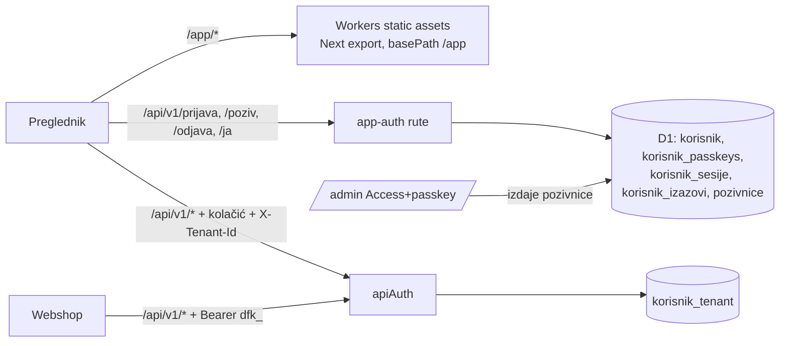

# Plan — dashboard: passkey i pozivnice umjesto GoTrue

## Zašto

Customer dashboard (`domovina-fiskal-app`) danas se prijavljuje dijeljenim GoTrue računom
(`api.domovina.ai`: Google i kod na e-mail), a pristup tenantu se veže po e-mailu u
`korisnik_tenant`. Identitet tako ovisi o drugom servisu (Coolify, Supabase), a e-mail OTP je
slabiji od passkeya. Cilj je da sve bude u fiskal Workeru i D1: passkey prijava, pozivnice
kao jedini ulaz, dashboard na istom originu kao API. Model je onaj koji već radi u
`logomedo.com` (logopedi) i u fiskal `/admin`.

## Arhitektura

| Što | Prije | Poslije |
|---|---|---|
| Identitet | GoTrue `sub` + e-mail | redak `korisnik` (e-mail), passkeyi u D1 |
| Ulaz | bilo tko s Google računom, pa provjera `korisnik_tenant` | samo pozivnica (admin ili vlasnik tenanta) |
| Sesija | Supabase JWT u localStorage, Bearer | kolačić `__Host-fiskal_app`, u D1 samo sha-256 |
| Dashboard | CF Pages, `fiskal-app.domovina.ai`, CORS | isti Worker, `fiskal.domovina.ai/app` |
| Webshop API | `Bearer dfk_` | isto, ne mijenja se |

## Tvrdi uvjeti (svaka sesija)

- Repo je **javan**: nikakve tajne, e-mailovi stvarnih ljudi, tokeni ni linkovi pozivnica u repou ili u docs.
- `dfk_` grana `/api/v1` ponaša se točno kao prije (postojeći testovi ostaju zeleni).
- Admin prijava (`src/admin/auth/*`, tablice `admin_*`) se ne dira; kupac s kolačićem dashboarda nikad ne dobiva pristup `/admin`.
- Sigurnosnu logiku držati u skladu s `~/git/logomedo/logomedo.com/src/lib/admin/*` (izvor kopije).
- Migracija uvijek prije deploya, s provjerom izlaza (nikad kroz `| tail`).
- Passkey i OTP unosi korisnik sam. Slanje linkova pozivnica, Access i brisanje Cloudflare resursa radi korisnik.

## Sesije

| # | Faza | Paket | Odluke | Gotovo kad |
|---|---|---|---|---|
| S1 | F0 | Migracija + `app-auth/{passkey,sesija,pozivnice}.ts` + testovi | 100 | `npm run typecheck && npm test` zelen, `skipped 0`, novi testovi pokrivaju istek, jednokratnost, opoziv i neaktivnost |
| S2 | F1 | Rute prijave/poziva, `/api/v1` grana za kolačić, Origin, `/api/v1/clanovi` za vlasnika | 200 | testovi rute: prijava → kolačić → `GET /racuni` s `X-Tenant-Id`; operater/knjigovođa ne može pozivati (403); mutacija bez ispravnog `Origin` 403; `dfk_` testovi nepromijenjeni |
| S3 | F1 | `/admin` pozivnice i korisnici, trag radnji | 300 | testovi admin rute (izdaj, opozovi, novi passkey, deaktivacija briše sesije); typecheck + test zeleni |
| S4 | F2 | App na `/app` u assets Workera, passkey UI, bez Supabasea | 400 | `npm run build` appa i `typecheck` zeleni; `grep -r supabase` u appu prazan; lokalni e2e (virtualni autentifikator) prolazi ili je izmjereno zašto ne može |
| S5 | F3 | GoTrue van iz backenda, SPOT 24, TEST migracija + deploy + smoke | 500 | `grep -ri gotrue backend/src` prazan; `curl fiskal-test.domovina.ai/app/` 200; **vrata**: korisnik na TEST-u prošao pozivnicu i izdao račun |
| S6 | F4 | PROD: mjerenje korisnika, migracija, deploy, pozivnice | 600 | **vrata prije**: termin i obavijest korisnicima; PROD `/app/` 200, za svaki aktivni `korisnik_tenant` red otvorena pozivnica |
| S7 | F4 | Mirovina Pagesa i `fiskal-app` domene, GoTrue redirect, README, memorija | 700 | **vrata**: korisnik potvrdio brisanje; `curl -I fiskal-app.domovina.ai` 301 na `/app` |

## Procjena i rizici

- **7 sesija**, linearno. Paralelno se ne isplati: S2 i S3 diraju iste module, S4 ovisi o API-ju iz S2.
- **Vrata**: nakon S5 (korisnik testira passkey na TEST-u), prije S6 (termin PROD-a, jer stari dashboard prestaje raditi u trenutku deploya), u S7 (brisanje Cloudflare resursa).
- **Najrizičnije**:
  - S4: Next `output: export` s `basePath` u Workers static assets (SPA fallback, `?id=` rute) i e2e s virtualnim autentifikatorom. Ako virtualni autentifikator ne radi kroz alate, e2e ide ručno na TEST-u (S5 vrata).
  - S6: PROD deploy gasi stari dashboard. Između deploya i registracije passkeya kupac nema pristup. `dfk_` webshopovi ne osjete ništa.
- Trošak: nema LLM ni plaćenih API poziva. Cloudflare: postojeći Worker i D1.

## Gdje smo

S0 (23. 11. 2026.): plan napisan, koda nema.
